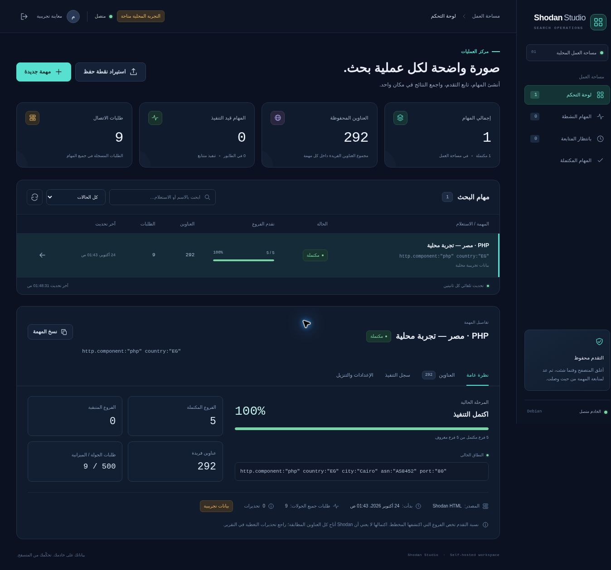

> **مستودع الأهداف ومهام الإثراء:** تجميع العناوين بين المهام، وفلاتر وإحصاءات

> **مساحة الإثراء المستقلة:** افتح `/enrichment` لمهام الإثراء و`/extraction`
> للاستخراج. يعمل عامل من كل نوع بالتوازي، مع اتصال ومتصفح مستقلين.
> تفاصيل التثبيت والعزل: [دليل مساحات التنفيذ](docs/ENRICHMENT_SPACES_AR.md).

> وسجل اكتشاف، مع إثراء HTML/API/تلقائي ومتصفح تفاعلي واستكمال.
> [الدليل وحدود التحقق](docs/TARGET_REPOSITORY_AR.md).

> **VPN Manager (1.3):** إدارة ملفات AmneziaWG/WireGuard، وعزل عامل البحث،
> وتعافٍ شبكي محدود مع حفظ النتائج. [دليل الاستخدام](docs/VPN_MANAGER_AR.md) ·
> [التثبيت والترقية والتراجع](docs/VPN_DEPLOYMENT_AR.md) ·
> [نتائج الاختبارات والقيود](docs/VPN_VALIDATION.md).
> يدعم قائمة دول اشتراك Premium بهوية عامل مستقلة، دون تصدير ملف لكل دولة.
> [ربط الاشتراك وحدود التوافق](docs/VPN_PREMIUM_AR.md).
> [تحسين زمن التبديل وتشخيص رفض HTML](docs/VPN_PERFORMANCE_AR.md).

# Shodan Studio 1.3.1 — دليل التشغيل على Debian 12

تطبيق ذاتي الاستضافة لإدارة مهام ShodanSpider من المتصفح. تعمل الواجهة والخادم ومحرك الجمع على جهاز Debian؛ ويمكن فتح الواجهة من متصفح جهاز آخر. يستمر تنفيذ المهام بعد إغلاق صفحة المتصفح عندما يكون الخادم قيد التشغيل. يضيف التطبيق طابور مهام وسجلًا للتقدم وحفظًا للاستكمال فوق محرك ShodanSpider، مع الاحتفاظ بالاستعلام الأصلي وقيوده أثناء التقسيم.



الصورة أعلاه تعرض بيانات اصطناعية لتوضيح الواجهة، وليست نتائج بحث حي من Shodan. تفاصيل التنفيذ في `ARCHITECTURE.md`، ونتائج الاختبارات وحدودها في `VALIDATION.md`.

## 1. المتطلبات

- Debian 12، مع Python 3.10 أو أحدث. [حزمة `python3` الافتراضية في Debian 12](https://packages.debian.org/bookworm/python3) تستخدم Python 3.11.
- `curl` عند اختيار وسيلة الاتصال `curl`، وهي الإعداد الافتراضي. يمكن اختيار `python` من إعدادات المهمة.
- شهادات النظام الموثوقة عبر حزمة `ca-certificates`.
- متصفح حديث على جهازك.
- اتصال يسمح بالوصول إلى Shodan، وصلاحيات الحساب المناسبة عند استخدام API.

الوظائف الأساسية لا تحتاج إلى حزم `pip` أو Node.js أو قاعدة بيانات منفصلة؛ يستخدم SQLite ضمن مكتبة Python القياسية. هذا الإصدار مخصص لمستخدم واحد على جهاز شخصي أو شبكة داخلية موثوقة. خادم HTTP المرفق مبني على `wsgiref`؛ ليس إعداد استضافة عامة مقوّى للإنترنت، وهو قيد مذكور أيضًا في [وثائق Python](https://docs.python.org/3.11/library/wsgiref.html).

تكامل Premium الاختياري يحتاج حزمة Debian `python3-cryptography`؛ راجع دليل الربط أعلاه.

يمكن حفظ عدة حسابات Shodan واختيار حساب للمهمة وتسجيل الدخول عبر المتصفح المعزول؛ راجع [دليل حسابات Shodan](docs/SHODAN_ACCOUNTS_AR.md). تحتاج الخاصية أيضًا إلى `python3-cryptography`.

تثبيت حزم Debian المطلوبة:

```bash
sudo apt update
sudo apt install python3 curl ca-certificates unzip
```

إذا كنت تعمل بحساب `root`، يمكنك تنفيذ أوامر إدارة النظام دون `sudo`.

## 2. أسرع طريقة للتشغيل

فك ضغط الحزمة وانتقل إلى مجلدها:

```bash
unzip Shodan-Studio-1.1.0-Debian12.zip
cd shodan-studio
bash start.sh
```

على جهاز Debian نفسه افتح:

```text
http://127.0.0.1:8787
```

عند أول تشغيل يظهر رمز التهيئة في الطرفية، ويوجد أيضًا في:

```bash
cat data/setup-token.txt
```

أدخل رمز التهيئة في الصفحة، واختر اسم مستخدم وكلمة مرور من 12 حرفًا على الأقل. يُستخدم الرمز للتهيئة الأولى فقط، ثم يُحذف ملفه بعد نجاح إنشاء الحساب. في الزيارات التالية تستخدم اسم المستخدم وكلمة المرور.

التشغيل بهذه الطريقة مرتبط بعملية الخادم في الطرفية. لإيقافه اضغط `Ctrl+C`. لكي يستمر بعد إغلاق جلسة SSH أو إعادة تشغيل Debian، استخدم خدمة `systemd` الموضحة أدناه.

### الدخول من متصفح جهاز آخر على الشبكة

اعرف عنوان Debian الذي يستطيع جهازك الوصول إليه:

```bash
hostname -I
```

قد يعرض الأمر أكثر من عنوان. اختر عنوان واجهة الشبكة المناسبة، وليس عنوان شبكة داخلية خاصة بحاوية. إذا كان عنوان Debian مثلًا `192.168.1.50`، شغّل:

```bash
bash start.sh \
  --host 0.0.0.0 \
  --port 8787 \
  --allowed-hosts 192.168.1.50:8787,localhost:8787,127.0.0.1:8787
```

ثم افتح من متصفح جهازك:

```text
http://192.168.1.50:8787
```

استبدل المثال بعنوان Debian الحقيقي. `--host` يحدد الواجهة التي يستمع عليها الخادم؛ و`--allowed-hosts` تحدد العناوين التي تقبلها طلبات المتصفح، بما فيها المنفذ. لا تستخدم `0.0.0.0` في شريط عنوان المتصفح ولا داخل قائمة العناوين المسموح بها. إذا تغيّر عنوان Debian، حدّث القائمة أو استخدم اسمًا ثابتًا على شبكتك.

هذا الاتصال يستخدم HTTP دون تشفير، لذا اجعله داخل شبكة موثوقة. للدخول عن بعد أو عبر شبكة غير موثوقة، استخدم نفق SSH المبين في القسم التالي. لا يفتح المثبّت منافذ الجدار الناري تلقائيًا.

### الدخول عبر نفق SSH

يمكن إبقاء التطبيق على `127.0.0.1` ثم تشغيل هذا الأمر من جهازك:

```bash
ssh -L 8787:127.0.0.1:8787 USER@DEBIAN_IP
```

أبقِ جلسة SSH مفتوحة، ثم افتح في متصفح جهازك:

```text
http://127.0.0.1:8787
```

استبدل `USER` و`DEBIAN_IP` بمستخدم SSH وعنوان Debian. إذا كان المنفذ `8787` مشغولًا على جهازك، اختر منفذًا محليًا آخر وأضف عنوانه، مثل `127.0.0.1:8788`، إلى `--allowed-hosts` في إعدادات التطبيق. يحتاج العنوان الظاهر في المتصفح إلى تطابق كامل مع القائمة.

## 3. التثبيت كخدمة تستمر في الخلفية

يوفر المثبّت الآتي:

| الجزء | الموقع أو الإعداد |
|---|---|
| حساب الخدمة | `shodan-studio`، حساب نظام دون صلاحيات root |
| إصدار التطبيق النشط | `/opt/shodan-studio/current` |
| إصدارات الكود المثبتة | `/opt/shodan-studio/releases/` |
| قاعدة البيانات والمهام والنتائج | `/var/lib/shodan-studio/` |
| إعدادات عنوان الاستماع | `/etc/default/shodan-studio` |
| وحدة systemd | `shodan-studio.service` |

للتشغيل المحلي أو عبر SSH tunnel:

```bash
sudo bash install-debian.sh
```

للدخول المباشر من جهاز آخر على الشبكة، مع استبدال عنوان المثال:

```bash
sudo bash install-debian.sh \
  --host 0.0.0.0 \
  --port 8787 \
  --allowed-hosts 192.168.1.50:8787,localhost:8787,127.0.0.1:8787
```

بعد بدء الخدمة، اقرأ رمز التهيئة الأولى:

```bash
sudo cat /var/lib/shodan-studio/setup-token.txt
```

إذا أكملت التهيئة سابقًا في مسار بيانات الخدمة فلن يكون ملف الرمز موجودًا، ويُستخدم الحساب الذي أنشأته. التشغيل اليدوي يستخدم `./data` افتراضيًا، أما الخدمة فتستخدم `/var/lib/shodan-studio`؛ المساران يمثلان حالتين مستقلتين ما لم تنقل البيانات بينهما بنفسك بعد إيقاف الخادم.

أوامر الإدارة:

```bash
sudo systemctl status shodan-studio --no-pager
sudo journalctl -u shodan-studio -n 100 --no-pager
sudo systemctl restart shodan-studio
sudo systemctl stop shodan-studio
sudo systemctl start shodan-studio
```

للتحقق من الحزمة والإعدادات قبل التثبيت دون تعديل النظام:

```bash
bash install-debian.sh --check
```

وللتثبيت دون بدء الخدمة أو تفعيلها تلقائيًا:

```bash
sudo bash install-debian.sh --no-start
sudo systemctl enable --now shodan-studio
```

المثبّت يتحقق من Debian 12 ووجود `systemd` عند التثبيت الفعلي، ولا يثبت حزم النظام ولا يغيّر قواعد الجدار الناري. ينشئ إصدارًا جديدًا للكود ويبدّل الرابط إلى الإصدار النشط، مع الإبقاء على مجلد البيانات. عند إعادة التثبيت دون خيارات اتصال، يحتفظ بملف الإعدادات الحالي. عند تمرير أي خيار اتصال، يعيد إنشاء الإعدادات بقيم الخيارات المقدمة والقيم الافتراضية للبقية؛ مرّر جميع الإعدادات التي تريد الاحتفاظ بها.

## 4. إضافة مهمة من المتصفح

بعد تسجيل الدخول:

1. اضغط زر إضافة مهمة.
2. اكتب اسمًا للمهمة والاستعلام في الحقل المخصص.
3. اختر مصدر البيانات: `HTML` أو `API` أو الوضع التلقائي.
4. عند اختيار API أدخل مفتاحك في حقل المفتاح. يرسل المتصفح المفتاح إلى خادم Debian، لذلك استخدم اتصالًا موثوقًا أو نفق SSH.
5. اضبط ميزانية الطلبات والفاصل الزمني ونوع IP وطريقة التقسيم إذا احتجت.
6. أضف المهمة إلى الطابور ثم افتح تفاصيلها لمتابعة التنفيذ.

مثال استعلام داخل حقل الواجهة:

```text
http.component:"php" country:"EG"
```

أو:

```text
"X-Powered-By: PHP/8.1.34" country:"JP"
```

اكتب الاستعلام نفسه فقط. لا تضف `-q` أو اسم السكربت أو علامات اقتباس خارجية خاصة بأوامر Bash؛ حقل الواجهة يرسل النص مباشرة. تحافظ الفروع على الاستعلام الأساسي وعلى قيود الدولة والمدينة والفلاتر التي أُضيفت أثناء التقسيم.

تشغّل قائمة الانتظار مهمة جمع واحدة في الوقت نفسه. هذا يجعل ترتيب المهام واضحًا ويمنع تضاعف معدل الطلبات بسبب تشغيل عدة عمليات بالتوازي. انتهاء المهمة الحالية يسمح ببدء التالية، وتُحفظ حالة كل مهمة منفصلة.

## 5. ماذا تعرض لوحة التحكم؟

| المؤشر | المعنى |
|---|---|
| الحالة | في الانتظار، تعمل، متوقفة مؤقتًا، تحتاج تدخّلًا، مكتملة أو فشلت |
| المرحلة | اكتشاف الدول والمدن، تخطيط التقسيم، استخراج IP، أو انتظار |
| عناوين IP | العناوين الفريدة التي جُمعت بعد تطبيق فلتر IPv4/IPv6 |
| الطلبات | إجمالي الطلبات منذ إنشاء المهمة، مع طلبات التشغيل الحالي وميزانيته |
| الفروع | عدد الفروع المعروفة والجاهزة أو المنجزة أو المتبقية |
| الاستعلام الحالي | نطاق الفرع الذي يعمل عليه المحرك الآن |
| السجل | أحداث التنفيذ والتحذيرات والأخطاء وأسباب الانتظار |
| المصدر | HTML أو API، بما في ذلك التغييرات أثناء الاستكمال |

المؤشر الرئيسي في القائمة والتفاصيل مبني على IP الفريد المخزن لكل مهمة في SQLite: «X من أصل نحو Y عنوان IP» مع «تقديري». أثناء التخطيط أو عند غياب مقام موثوق يظهر «الإجمالي غير معروف بعد» بلا نسبة. تبقى الفروع عدّادًا ثانويًا. لا تظهر 100% إلا عند اكتمال الفروع المخططة بنجاح؛ ولا تعني ضمان تغطية جميع بيانات Shodan. تفاصيل الحساب والترقية والرجوع في [دليل مؤشر IP](docs/IP_PROGRESS_AR.md).

التقسيم يعطي الأولوية للفروع المناسبة للاستخراج، ثم يبدأ بالأكبر بين الفروع التي لا تتجاوز حد الفرع المستهدف. عدد سجلات Shodan قد يختلف عن عدد العناوين الفريدة؛ فالـfacets تجمع قيم حقول الـbanner وفق [توضيح Shodan](https://book.shodan.io/websites/www/facet-analysis/)، وقد يظهر عنوان واحد في أكثر من منفذ أو سجل. ترتيب الفروع بهذا المعيار يحسن الاستفادة من الطلبات في حالات كثيرة، لكنه ليس برهانًا على أقل عدد ممكن من الطلبات في كل استعلام.

## 6. الإيقاف والاستكمال وتغيير المصدر

زر الإيقاف المؤقت يطلب من العامل حفظ التقدم والتوقف عند نقطة مناسبة. إذا كان هناك طلب شبكي جارٍ، قد ينتظر إنهاءه أو انتهاء مهلة الاتصال؛ لذلك تظهر حالة طلب الإيقاف قبل اكتمال الإيقاف الفعلي.

يمكن استكمال مهمة محفوظة، وإعادة إدخال مفتاح API أو تغيير المصدر إلى HTML أو API من إجراءات المهمة. يعتمد الاستكمال على الـcheckpoint ويحافظ على العناوين التي سبق جمعها. التحويل إلى مصدر آخر لا يعني أن له الصلاحيات نفسها أو التغطية نفسها؛ يعرض التقرير مصدر الصفحات وأي فجوات أو تحذيرات. طلبات التشغيل الحالي تُقارن بميزانية ذلك التشغيل، أما إجمالي الطلبات فيبقى تراكميًا عبر مرات الاستكمال.

عندما يحتاج المحرك إلى اختيار من المستخدم، يعرض التطبيق المهمة بحالة تحتاج تدخّلًا، بدل طلب الإدخال في طرفية مخفية. افتح تفاصيل المهمة، راجع الخطأ، ثم اختر الاستكمال بالمصدر أو المفتاح المناسب.

عند إعادة تشغيل خدمة Debian، تبقى المهام والنتائج محفوظة. المهمة التي كانت تعمل تصبح مهمة متوقفة أو منقطعة قابلة للمراجعة والاستكمال؛ لا يُفترض أن إعادة تشغيل الخادم تعني موافقتك على تكرار الطلب الجاري. قد تحتاج إلى إدخال مفتاح API مجددًا.

### حدود الحساب وHTTP 429

- أخطاء `401` و`402` و`403` قد تنتج عن المفتاح أو صلاحيات الحساب أو رصيد البحث. لا يمكن اعتبار كل `403` دليلًا على انتهاء الرصيد.
- عند تمكين الرجوع إلى HTML، يمكن للمحرك تجربة المصدر الآخر في الأخطاء المؤهلة. إذا لم يكن المصدر متاحًا، تتوقف المهمة للمراجعة أو التدخّل.
- `429` يعني تقييد معدل الطلبات. يحترم المحرك الانتظار وسياسة إعادة المحاولة، ويحفظ موعد الاستكمال عند توفره.
- تغيير `User-Agent` يغير ترويسة HTTP؛ لا يغير المتصفح الفعلي ولا يضيف اشتراكًا أو رصيدًا للحساب.

فشل المصدرين لا يحول تلقائيًا إلى نتائج فارغة ناجحة. احتفظ بالتقرير عند تقييم اكتمال البيانات.

## 7. النتائج والتقارير

تعرض تفاصيل المهمة معاينة العناوين وتسمح بتنزيل الملفات التي يوفرها التطبيق:

- TXT: عنوان واحد في كل سطر.
- CSV أو JSON: تصدير العناوين للاستخدام في أدوات أخرى.
- التقرير: الحالة، أعداد الطلبات، الفروع، التحذيرات، وأخطاء أو فجوات الجمع.
- Checkpoint: التقدم القابل للاستيراد والاستكمال.

النتائج الجزئية تظل مرتبطة بحالة المهمة؛ وجود ملف لا يعني أن الجمع اكتمل. كذلك انتهاء المحرك بنجاح لا يثبت أن Shodan كشف كل المدن أو ASN أو قيم الـfacets أو العناوين. التقرير هو موضع مراجعة هذه الحدود.

## 8. استيراد تقدم سكربت سابق

من إجراء استيراد Checkpoint اختر ملف التقدم JSON الخاص بالنسخة المتوافقة من ShodanSpider v6 أو v7. ينشئ التطبيق مهمة مستقلة ويعيد ربط مخرجاتها بمجلد البيانات الخاص به. لا يشغّل مسارات أو أوامر واردة في الملف المستورد. تُضاف المهمة المستوردة متوقفة للمراجعة؛ اضغط استكمال بعد التحقق من مصدرها وإعداداتها.

حدد مصدر الاستكمال عند الحاجة. المفتاح لا يُؤخذ من الملف؛ أدخله في الحقل المخصص إذا أردت API. ملف TXT الذي يحتوي عناوين فقط ليس Checkpoint، ولا يكفي لاستعادة خطة الفروع أو موضع الصفحات السابقة.

## 9. وضع التجربة دون اتصال بـShodan

لتفعيل المهام التجريبية أثناء التحقق من الواجهة:

```bash
bash start.sh --demo
```

فعّل خيار المهمة التجريبية في نافذة إضافة المهمة. تعرض المهمة التجريبية بيانات مصطنعة وموسومة بوضوح لتجربة تدفق العمل وحالات التقدم والتنزيل دون إرسال استعلامات إلى Shodan. هذه النتائج ليست عناوين مكتشفة من استعلامك. علم `--demo` يتيح إنشاء هذه المهام؛ لا يمنع إنشاء مهمة حقيقية إذا ألغيت اختيار التجربة. المهمة الحقيقية تستخدم الاتصال الخارجي والمصدر المحدد وصلاحياته.

## 10. مكان حفظ البيانات والمفاتيح

في التشغيل اليدوي تُحفظ الحالة تحت المسار الذي تعطيه لـ`--data-dir`، وافتراضيًا في `data` داخل مجلد التطبيق. في الخدمة تكون الحالة في `/var/lib/shodan-studio`.

يستخدم التطبيق SQLite لحفظ المستخدم والمهام والأحداث والعناوين الفريدة لكل مهمة. كلمة المرور تُحفظ كمشتق مملّح باستخدام PBKDF2، ولا تُحفظ كنص واضح. مفاتيح Shodan تُحتفظ بها في ذاكرة العملية للمهمة فقط، ولا توضع في معاملات تشغيل العامل أو قاعدة البيانات أو الملفات المصدّرة. بعد إعادة تشغيل الخدمة قد يطلب منك المفتاح مرة أخرى. لا تضع مفتاحًا داخل عنوان المهمة أو نص الاستعلام أو التعليقات؛ تلك حقول تُحفظ كجزء من المهمة.

### نسخة احتياطية متسقة

أوقف الخدمة قبل نسخ مجلد البيانات حتى لا تُنسخ قاعدة SQLite وملفات التقدم أثناء الكتابة:

```bash
sudo systemctl stop shodan-studio
sudo tar -C /var/lib -czf shodan-studio-data-backup.tar.gz shodan-studio
sudo chmod 600 shodan-studio-data-backup.tar.gz
sudo systemctl start shodan-studio
```

النسخة الاحتياطية تحتوي نتائج ومهام وبيانات الحساب، لذا احفظها في مكان خاص. احتفظ بمجلد البيانات كاملًا، وليس ملف `studio.sqlite3` وحده أثناء تشغيل الخدمة. ترقية الكود لا تحتاج حذف هذا المجلد.

## 11. حل المشكلات المعتادة

### الصفحة لا تفتح من الجهاز الآخر

تحقق من عنوان Debian والمنفذ، ومن تشغيل الخدمة، ومن `--host` و`--allowed-hosts`. الاستماع إلى `127.0.0.1` فقط يسمح بالوصول المحلي أو عبر SSH tunnel. إذا كانت الإعدادات صحيحة، راجع جدار Debian الناري ووضع شبكة الجهاز الافتراضي؛ وصول المتصفح إلى عنوان VM يعتمد على إعداد شبكتك.

```bash
sudo systemctl status shodan-studio --no-pager
sudo ss -ltnp
```

### رسالة Host غير مسموح

أضف العنوان المكتوب في المتصفح مع المنفذ إلى `SHODAN_STUDIO_ALLOWED_HOSTS` في `/etc/default/shodan-studio`، ثم أعد تشغيل الخدمة. لا تستخدم نجمة `*`؛ القائمة تقبل عناوين محددة.

### مفتاح API لا يعمل

راجع رسالة Shodan في سجل المهمة، وصلاحيات البحث والاشتراك ورصيد الحساب. نجاح قراءة الـfacets لا يعني بالضرورة السماح بتنزيل نتائج البحث؛ تميز [وثائق API الرسمية](https://developer.shodan.io/api) بين طلب العدّ الذي لا يعيد نتائج المضيفين ولا يستهلك رصيد البحث، وطلب البحث الذي قد يستهلكه حسب الاستعلام والصفحات. جرّب الاستكمال بالمصدر الآخر عندما يكون متاحًا، أو قدّم مفتاحًا بصلاحية مناسبة.

### المهام لا تعمل بعد إعادة التشغيل

المهمة التي انقطع تنفيذها تحتاج مراجعة واستكمالًا من الواجهة. إذا كانت تعتمد على API، أعد إدخال المفتاح؛ لا يوجد مخزن دائم للمفاتيح في هذا الإصدار. راجع أيضًا الطلبات المتبقية وسياسة الانتظار وأخطاء المصدر.

### خطأ شهادة أو DNS أو اتصال

راجع الخطأ الأصلي في سجل المهمة. تأكد من الوقت الصحيح على Debian، ومن شهادات `ca-certificates` واتصال الشبكة وإعداد البروكسي إن كان موجودًا. لا يتطلب التطبيق تعطيل التحقق من شهادة TLS لمعالجة هذه المشكلة.

### الوصول عبر HTTPS أو خادم أمامي

يتوفر `--secure-cookies` للاستخدام عندما يقدم خادم أمامي موثوق اتصال HTTPS. هذا الخيار لا ينشئ شهادة ولا يضيف HTTPS إلى الخادم المرفق. لا تفعّله مع وصول HTTP عادي؛ المتصفح لن يرسل Cookie الآمنة. إعداد نشر عام يحتاج خادم تطبيق وإعداد TLS وحدود اتصال ومراجعة تشغيلية مناسبة؛ لا تعتبر وضع خادم أمامي وحده تحويلًا لخادم `wsgiref` إلى إعداد إنتاجي عام. للاستخدام الفردي عن بعد، نفق SSH هو المسار الموثق في هذه الحزمة.

## 12. الاختبارات ومراجع المنصة

تشغيل اختبارات التطبيق المحلية من المجلد:

```bash
python3 -m unittest discover -s tests -v
```

الاختبارات المحلية تستخدم بيانات بديلة ولا تحتاج مفاتيح Shodan حقيقية. راجع `VALIDATION.md` المرفق لمعرفة نتائج التحقق الفعلية والاختبارات التي لم تستطع بيئة البناء تنفيذها. التوافق البرمجي مع Debian 12 لا يعادل اختبار شبكتك أو اشتراك حسابك.

المراجع الرسمية:

- [حزمة Python 3 في Debian 12](https://packages.debian.org/bookworm/python3).
- [إعداد بيئة خدمات systemd 252](https://www.freedesktop.org/software/systemd/man/252/systemd.exec.html).
- [مرجع Python 3.11 لخادم WSGI وحدوده](https://docs.python.org/3.11/library/wsgiref.html).
- [مرجع Shodan API](https://developer.shodan.io/api).
- [شرح Shodan لتحليل Facets](https://book.shodan.io/websites/www/facet-analysis/).


## استرداد جلسة المتصفح عبر Patchright — 1.6.0

يمكن لمهام HTML عبر VPN فتح المتصفح مرة واحدة عند ظهور تحقق Cloudflare، ثم
انتظار الفحص والاستكمال اليدوي. راجع [التثبيت والسياسة والترقية والرجوع](docs/PATCHRIGHT_RECOVERY.md).
